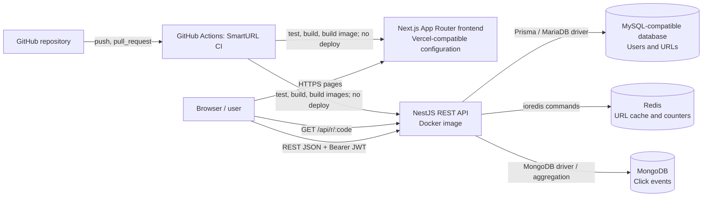

# SmartURL — System Architecture

## Components and trust boundaries

The placement of the frontend on Vercel or the API on Render is not encoded as a live deployment. The diagram identifies the components and protocols implemented by the source. `frontend/vercel.json` supports a Vercel frontend build, while the actual API runtime is described by `backend/Dockerfile`. The selected remote providers and production network links cannot be confirmed from this repository.

## Backend module organization

`backend/src/app.module.ts` loads global configuration and imports `PrismaModule`, `RedisModule`, `MongoModule`, `AuthModule`, `UrlsModule`, and `AnalyticsModule`. These modules provide their clients/services through Nest dependency injection. Prisma, Redis, and Mongo client providers are global where appropriate.

`backend/src/main.ts` creates the Nest application, calls `configureHttpApp`, enables shutdown hooks, and listens on `PORT` or `API_PORT` at `0.0.0.0`. `configureHttpApp` applies `/api`, CORS, trusted-proxy settings, and the global validation pipe.

## Storage separation

1. `User` and `Url` records are persisted to MySQL through Prisma.
2. Redis accelerates redirect resolution and enforces fixed-window counters; it is a derived/cache layer, not the canonical URL database.
3. MongoDB stores click-event documents. Analytics endpoints aggregate these documents and combine them with URL metadata from MySQL.

## Implemented versus unverified

| Statement | Status |
|---|---|
| API calls Redis, MySQL, and MongoDB | Implemented in backend services |
| Local Docker network and containers | Implemented in `docker-compose.yml` |
| Frontend can use Vercel framework/build configuration | Configuration present; deployment not verified |
| Backend runs as a Docker container | Dockerfile and Compose service present |
| API is hosted on Render | Not established by source/configuration |
| MySQL endpoint is TiDB Cloud | Not established |
| Redis endpoint is Upstash | Not established |
| Mongo endpoint is Atlas | Not established |
| CI deploys either application | Not implemented in the inspected workflow |

