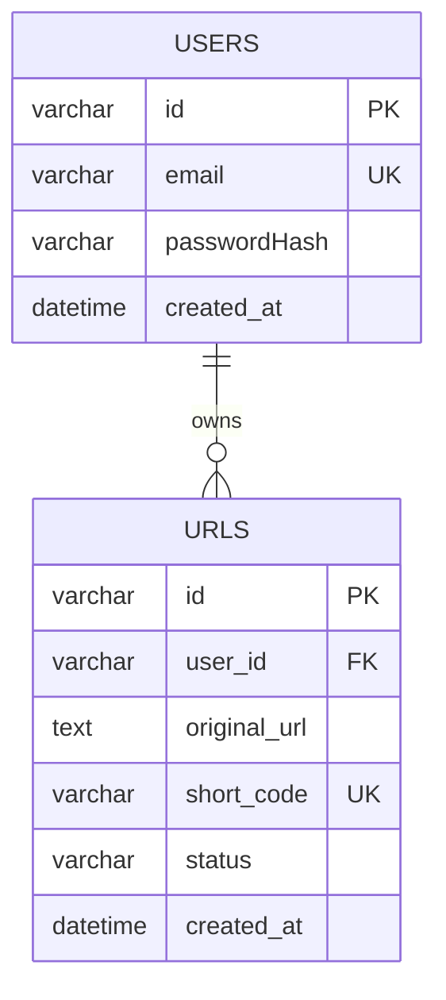

# SmartURL — MySQL / Prisma Database Design

## Data model

The schema is in `backend/prisma/schema.prisma`; the checked-in initial migration is `backend/prisma/migrations/20261115000000_init/migration.sql`. Prisma 7 gets the connection URL through `backend/prisma.config.ts`; runtime uses `PrismaService` and `createMariaDbAdapter` in `backend/src/prisma/`.

### `users`

| Column | Type | Constraints / behavior |
|---|---|---|
| `id` | `VARCHAR(30)` | Primary key; Prisma `cuid()` default |
| `email` | `VARCHAR(254)` | Unique; normalized to lowercase and trimmed by `AuthService` |
| `passwordHash` | `VARCHAR(255)` | Stores `salt:derived-hash`, never the submitted password |
| `created_at` | `DATETIME(3)` | Defaults to current timestamp |

### `urls`

| Column | Type | Constraints / behavior |
|---|---|---|
| `id` | `VARCHAR(30)` | Primary key; Prisma `cuid()` default |
| `user_id` | `VARCHAR(30)` | Foreign key to `users.id`; cascade on user delete/update |
| `original_url` | `TEXT` | Destination validated by API as HTTP or HTTPS, maximum 2048 characters |
| `short_code` | `VARCHAR(16)` | Unique; random or optional validated custom value |
| `status` | `VARCHAR(16)` | Defaults to `ACTIVE`; implementation accepts `ACTIVE` or `DISABLED` |
| `created_at` | `DATETIME(3)` | Defaults to current timestamp |

The schema does not declare a status enum or an `updatedAt` column. A short-code index and compound indexes are declared in Prisma/migration.

## ER diagram

MongoDB `click_events` is intentionally not shown as a relational foreign-key relation: it is a separate document collection, and the source does not define cross-database foreign keys.

## Keys and indexes

- `users.id`: primary key.
- `users.email`: unique index `users_email_key`.
- `urls.id`: primary key.
- `urls.short_code`: unique index `urls_short_code_key`.
- `urls(user_id, created_at)`: index `urls_user_id_created_at_idx`.
- `urls(status, short_code)`: index `urls_status_short_code_idx`.
- `urls.user_id` references `users.id` with `ON DELETE CASCADE ON UPDATE CASCADE`.

## CRUD behavior

- **Create:** `UrlsService.create` stores a URL under the authenticated `userId`. A supplied custom code is saved once; random codes are generated from 5 random bytes and retried up to five times on a unique-code collision. The response includes a shareable URL and a zero click count. It does not create a Redis entry until a redirect miss.
- **Read/list:** `UrlsService.list` restricts queries to the user, optionally searches `originalUrl` or `shortCode`, sorts newest first, and returns at most 200 rows. MongoDB supplies click counts for those codes.
- **Update:** `setStatus` first checks ownership, validates status, updates MySQL, then deletes the Redis cache key. These are separate operations, not a transaction across stores.
- **Delete:** `remove` checks ownership, deletes the MySQL URL, then deletes its Redis key. It does not delete associated MongoDB click-event documents; the source has no TTL/retention or deletion routine for them.
- **User deletion:** the database relation cascades URL rows, but no user-deletion API is implemented. No cross-store event/cache cleanup for such a path is present.

