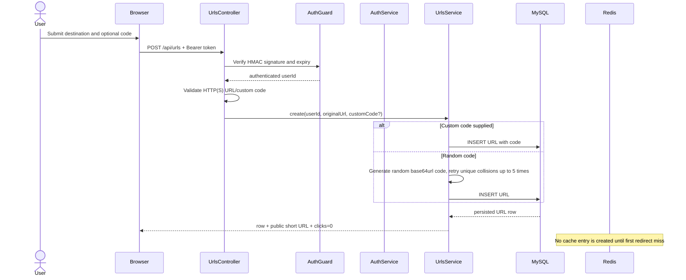
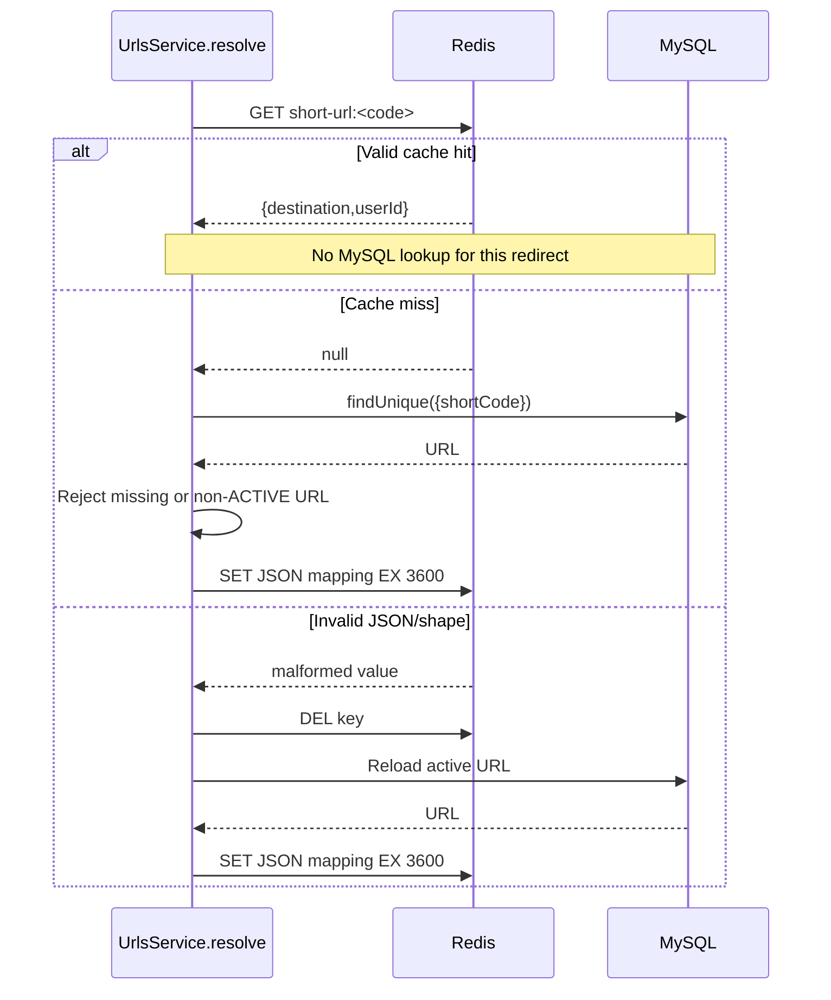

# SmartURL — Request and Data Flows

## A. Registration and login

```mermaid
sequenceDiagram
  actor User
  participant Browser
  participant API as NestJS AuthController
  participant Redis
  participant Auth as AuthService
  participant MySQL

  User->>Browser: Submit email and password
  Browser->>API: POST /api/auth/register or /api/auth/login
  API->>Redis: INCR email counter and hashed-IP counter; EXPIRE on first count
  alt Rate limit exceeded
    API-->>Browser: 429 Too Many Requests
  else Within limit
    API->>Auth: register(email,password) or login(email,password)
    alt Registration
      Auth->>Auth: normalize email; generate random salt; scrypt password
      Auth->>MySQL: INSERT users(email,passwordHash)
      MySQL-->>Auth: user id/email
    else Login
      Auth->>MySQL: SELECT user by normalized email
      MySQL-->>Auth: user and passwordHash
      Auth->>Auth: scrypt candidate; timing-safe compare
    end
    Auth->>Auth: create signed HS256 token with 7-day exp
    Auth-->>Browser: user and token
    Browser->>Browser: Save token/email in localStorage
  end
```

Duplicate registration is mapped from Prisma `P2002` to HTTP 409. Login failures return the same unauthorized message for unknown email and wrong password.

## B. Creating a shortened URL



## C. Opening a shortened URL and redirecting

```mermaid
sequenceDiagram
  actor Visitor
  participant API as UrlsController / UrlsService
  participant Redis
  participant MySQL
  participant Mongo as MongoDB click_events
  Visitor->>API: GET /api/r/:code
  API->>Redis: Check hashed-IP redirect counter (120 per 60s)
  alt Limit exceeded
    API-->>Visitor: 429
  else Allowed
    API->>Redis: GET short-url:<code>
    alt Cache hit
      Redis-->>API: JSON destination and userId
    else Cache miss or invalid mapping
      API->>MySQL: SELECT URL by short_code
      MySQL-->>API: URL row
      API->>API: Require ACTIVE
      API->>Redis: SET mapping EX 3600 (best effort)
    end
    API-->>Visitor: HTTP 302 Location: destination
    API--)Mongo: Insert parsed click event asynchronously; errors logged
  end
```

## D. Redis cache hit and miss



The code catches Redis `GET` and cache `SET` errors, but the preceding Redis rate-limit operation is mandatory. Mutations also call Redis `DEL` after committing their MySQL operation.

## E. Click analytics recording and retrieval

```mermaid
sequenceDiagram
  actor Visitor
  participant API as Redirect handler
  participant Mongo as MongoDB
  participant Browser as Signed-in dashboard
  participant Analytics as AnalyticsController/Service
  participant Guard as AuthGuard
  participant MySQL

  Visitor->>API: GET /api/r/:code
  API->>API: Resolve destination; derive UA/referrer fields
  API--)Mongo: insertOne click_events (fire-and-forget)
  API-->>Visitor: 302 redirect (does not await insert)
  Browser->>Analytics: GET /api/analytics + Bearer JWT
  Analytics->>Guard: Verify token
  Guard-->>Analytics: userId
  Analytics->>MySQL: Load user's codes and URL counts
  MySQL-->>Analytics: URL metadata
  Analytics->>Mongo: Aggregate counts, buckets, activity, recent events for codes
  Mongo-->>Analytics: analytics documents
  Analytics-->>Browser: totals, top URLs, activity, breakdowns, recent activity
```

Per-link analytics additionally checks URL ownership in MySQL before aggregating that code in MongoDB.

## F. Rate limiting

```mermaid
sequenceDiagram
  participant Client
  participant Controller as AuthController or UrlsService
  participant Redis
  Client->>Controller: Auth request or GET /api/r/:code
  Controller->>Controller: Select identity (normalized email and/or SHA-256 IP prefix)
  Controller->>Redis: INCR <counter-key>
  alt Counter equals 1
    Controller->>Redis: EXPIRE <counter-key> 60
  end
  Redis-->>Controller: counter
  alt Counter within configured limit
    Controller->>Controller: Continue request processing
  else Counter over limit
    Controller-->>Client: HTTP 429
  end
  Note over Controller,Redis: Redis command failure aborts request; there is no rate-limit fail-open path
```

